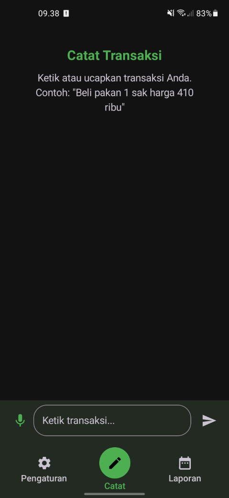
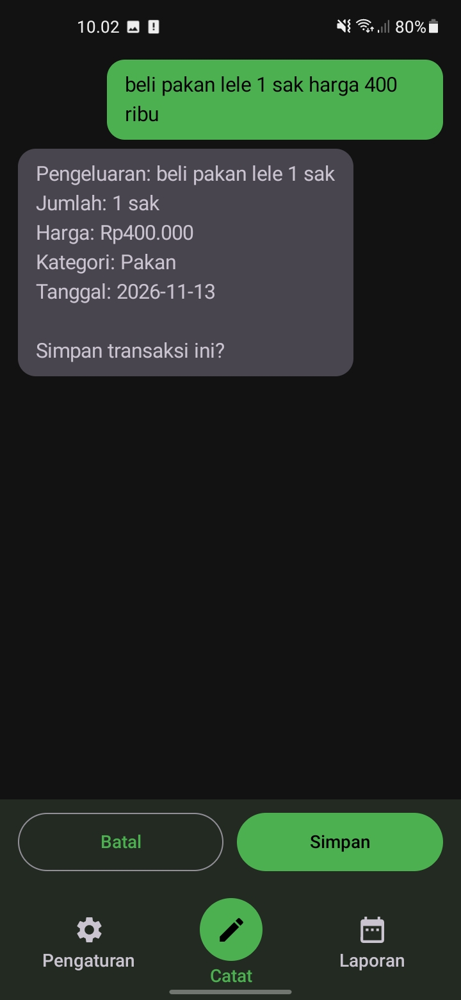
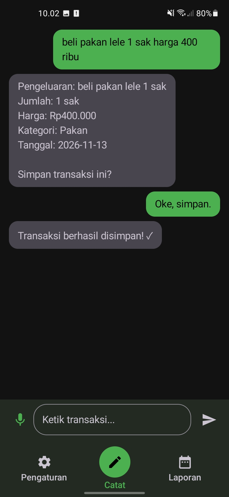
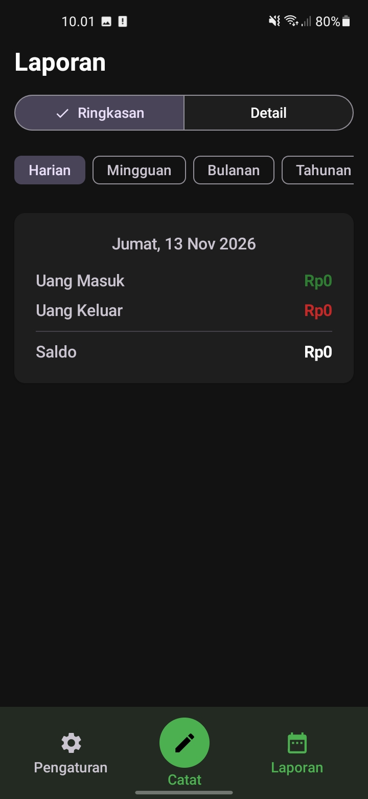
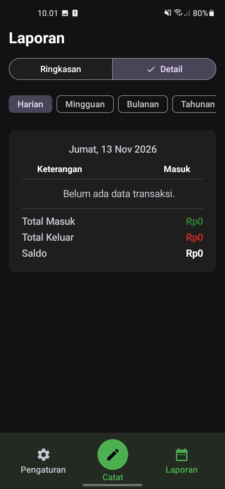
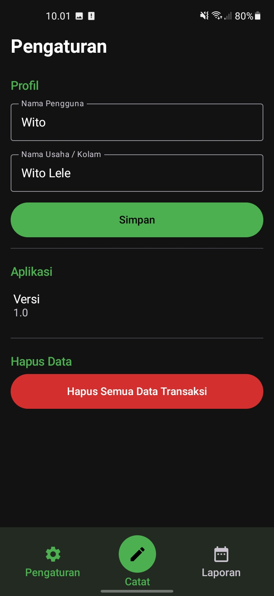

# Pengumpulan UTS Pemrograman Mobile

## Identitas Mahasiswa

- Nama: Rizal Maulana
- NIM: 2305101018
- Kelas: 7B
- Program Studi: Teknik Informatika
- Mata Kuliah: Pemrograman Mobile
- Tahun Akademik: 2026-2027

## Deskripsi

Repository ini berisi source code, dokumentasi, dan hasil implementasi aplikasi mobile **SungutLele** untuk pengerjaan Ujian Tengah Semester (UTS) mata kuliah Pemrograman Mobile.

## Deskripsi Pengerjaan UTS

**SungutLele** adalah aplikasi Android (frontend) untuk pencatatan keuangan dan aktivitas budidaya lele skala kecil. Aplikasi ini dirancang dengan antarmuka yang sederhana, ukuran teks yang besar, kontras yang jelas, serta alur pencatatan bergaya percakapan agar mudah digunakan oleh pembudidaya maupun pengguna non-teknis.

Aplikasi berfokus pada tiga alur utama melalui navigasi bawah (*bottom navigation*):
1. **Catat** (tombol utama di tengah) untuk mencatat pemasukan/pengeluaran melalui input teks maupun suara (*Speech-to-Text*) dengan langkah konfirmasi *draft* sebelum data disimpan.
2. **Laporan** untuk memantau ringkasan keuangan serta rincian transaksi berdasarkan periode waktu.
3. **Pengaturan** untuk mengelola informasi profil pengguna/usaha serta manajemen data aplikasi.

## Teknologi yang Digunakan

- **Bahasa Pemrograman:** Kotlin (`2.1.20`)
- **Framework & UI:** Android SDK, Jetpack Compose (Compose BOM `2025.05.01`), Material Design 3
- **Arsitektur & State Management:** MVVM (*Model-View-ViewModel*) dengan Kotlin `StateFlow`
- **Networking & Serialization:** Retrofit `2.11.0`, OkHttp, Gson Converter
- **Fitur Perangkat:** Android `RecognizerIntent` (*Speech-to-Text* Bahasa Indonesia `id-ID`)
- **Build System & Tools:** Android Studio, Gradle (AGP `9.4.0`), Kotlin Compose Compiler Plugin
- **Backend / API (Opsional pada UTS):** FastAPI REST API (`https://sungutlele2.vercel.app/api/v1/`)

## Fitur yang Diimplementasikan

1. **Catat Transaksi (`CatatScreen`)**
   - Input transaksi menggunakan keyboard maupun input suara (*Speech-to-Text* melalui tombol mikrofon dengan izin `RECORD_AUDIO`).
   - Tampilan riwayat percakapan interaktif (*chat bubble*) antara pengguna dan sistem.
   - Tahap konfirmasi (*Draft*) dengan tombol **Simpan** dan **Batal** untuk memastikan transaksi tidak tersimpan secara tidak sengaja.
2. **Laporan Keuangan (`LaporanScreen`)**
   - Dua mode tampilan: **Ringkasan** (*Uang Masuk*, *Uang Keluar*, *Saldo*) dan **Detail** (tabel *Tanggal*, *Keterangan*, *Masuk*, *Keluar* beserta total).
   - Filter 5 periode waktu: **Harian**, **Mingguan**, **Bulanan**, **Tahunan**, dan **Kustom** (*Date Range Picker*).
3. **Pengaturan (`PengaturanScreen`)**
   - Pengaturan profil (*Nama Pengguna* dan *Nama Usaha / Kolam*).
   - Informasi versi aplikasi (`1.0`).
   - Fitur *Hapus Semua Data Transaksi* dilengkapi dialog konfirmasi keamanan.

## Struktur Folder

```text
2305101018-7B-PROJECT/
├── .gitignore
├── README.md
└── uts/
    ├── SungutLele/                     # Source code project Android (Gradle / Kotlin / Compose)
    │   ├── app/
    │   │   ├── build.gradle.kts
    │   │   └── src/main/
    │   │       ├── AndroidManifest.xml
    │   │       ├── java/com/example/sungutlele/
    │   │       │   ├── data/           # API service, RetrofitClient, model, repository
    │   │       │   └── ui/             # Catat, Laporan, Pengaturan, Theme
    │   │       └── res/                # Resource ikon, warna, tema, dan string Android
    │   ├── gradle/
    │   ├── build.gradle.kts
    │   ├── settings.gradle.kts
    │   └── local.properties.example
    ├── assets/
    │   ├── icons/                      # Aset ikon launcher aplikasi
    │   └── images/                     # Aset gambar pendukung
    └── screenshots/                    # Bukti screenshot implementasi aplikasi
```

- `uts/SungutLele/`: Source code lengkap proyek Android beserta konfigurasi Gradle.
- `uts/assets/`: Salinan aset visual/ikon aplikasi (aset resource bawaan Android juga berada di `uts/SungutLele/app/src/main/res/`).
- `uts/screenshots/`: Bukti visual hasil implementasi aplikasi yang dijalankan pada emulator atau perangkat Android.

## Persyaratan Menjalankan Aplikasi

- **Android Studio** (disarankan versi terbaru yang mendukung Android Gradle Plugin `9.4.0` dan Kotlin `2.1.20`)
- **JDK 11** atau **JDK 17+** (sesuai konfigurasi Gradle / Android Studio; `compileOptions` menargetkan Java `11`)
- **Android SDK:** `compileSdk 37`, `targetSdk 37`, `minSdk 24` (Android 7.0 Nougat atau lebih baru)
- **Emulator Android** atau **Perangkat Android Fisik** (dengan koneksi internet apabila menguji pemanggilan API)

## Cara Menjalankan Aplikasi

1. **Clone repository** ini atau unduh sebagai ZIP:
   ```bash
   git clone https://github.com/rzlmiooo/2305101018-7B-PROJECT.git
   ```
2. Buka **Android Studio**, pilih **Open**, lalu arahkan ke subfolder **`uts/SungutLele`** (bukan folder root repository).
3. Tunggu proses **Gradle Sync** selesai. Android Studio akan membuat file `local.properties` (`sdk.dir`) secara otomatis.
4. *(Opsional)* Konfigurasi API & Token:
   - Secara default, alamat server diatur di `uts/SungutLele/app/src/main/java/com/example/sungutlele/data/api/RetrofitClient.kt` (`BASE_URL = "https://sungutlele2.vercel.app/api/v1/"`).
   - Apabila menggunakan server lokal atau token otorisasi khusus, sesuaikan `BASE_URL` dan tambahkan `ACCESS_TOKEN` di `uts/SungutLele/local.properties` (lihat `local.properties.example`).
5. Pilih target **Emulator** atau **HP Android** yang sudah terhubung (USB Debugging aktif).
6. Klik tombol **Run** (`Shift + F10`) untuk membangun dan menjalankan aplikasi.

### Build APK melalui Terminal (Opsional)

Dari dalam folder `uts/SungutLele`:
```bash
./gradlew assembleDebug
```
*(Di Windows PowerShell/CMD gunakan `.\gradlew.bat assembleDebug`.)*

## Screenshot Hasil Implementasi

Dokumentasi tampilan aplikasi disimpan di folder `uts/screenshots/`:

| Halaman / Fitur | File Screenshot | Pratinjau |
| --- | --- | --- |
| Halaman Utama — Catat Transaksi | `uts/screenshots/01-halaman-utama-catat.png` |  |
| Catat — Konfirmasi Draft Transaksi | `uts/screenshots/02-catat-konfirmasi-draft.png` |  |
| Catat — Transaksi Tersimpan | `uts/screenshots/03-catat-transaksi-tersimpan.png` |  |
| Halaman Laporan — Mode Ringkasan | `uts/screenshots/04-laporan-ringkasan.png` |  |
| Halaman Laporan — Mode Detail | `uts/screenshots/05-laporan-detail.png` |  |
| Halaman Pengaturan | `uts/screenshots/06-pengaturan.png` |  |

## File APK

File APK hasil kompilasi tersedia melalui halaman **GitHub Releases** pada repository ini:

- **GitHub Releases:** https://github.com/rzlmiooo/2305101018-7B-PROJECT/releases

## Referensi

- Dokumentasi Resmi Jetpack Compose: https://developer.android.com/jetpack/compose
- Dokumentasi Material Design 3 untuk Compose: https://developer.android.com/develop/ui/compose/designsystems/material3
- Dokumentasi Retrofit: https://square.github.io/retrofit/
- Dokumentasi Android `RecognizerIntent` (Speech-to-Text): https://developer.android.com/reference/android/speech/RecognizerIntent
